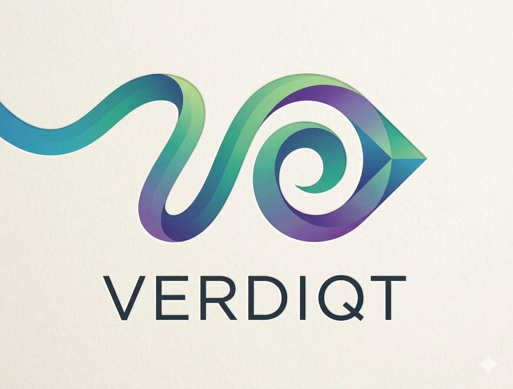

<div align="center">



# Verdiqt

### AI-Powered Multilingual Sentiment Analysis Chrome Extension

[](https://python.org)
[](https://fastapi.tiangolo.com)
[](https://developer.chrome.com/docs/extensions/)
[](https://huggingface.co/cardiffnlp/twitter-xlm-roberta-base-sentiment)
[](LICENSE)

**Analyze the sentiment of any webpage — reviews, comments, posts — in 100+ languages, in real time.**

[Features](#-features) • [Demo](#-demo) • [Installation](#-installation) • [How It Works](#-how-it-works) • [Tech Stack](#-tech-stack) • [Model](#-the-ai-model)

</div>

---

## 📸 Demo

> Visit any product page, news article, or social media feed → click the **V** button → get instant sentiment analysis with colored badges on every review.

| Sidebar Analysis | Sentiment Badges |
|---|---|
| Shows % breakdown of Positive / Negative / Neutral | Color-coded badges appear next to each review |
| Detects languages automatically | Works on Amazon, Flipkart, Reddit, LinkedIn & more |

---

## ✨ Features

- 🌍 **100+ Languages** — English, Hindi, Tamil, Telugu, Arabic, French, German, Japanese, and more
- ⚡ **Real-time Analysis** — results appear in seconds
- 🏷️ **Visual Badges** — color-coded sentiment badges injected next to each review on the page
- 📊 **Summary Stats** — overall positive / negative / neutral percentage breakdown
- 🔒 **100% Local** — your data never leaves your machine; everything runs on localhost
- 🌐 **Works Everywhere** — Amazon, Flipkart, Reddit, Yelp, LinkedIn, Medium, and any site with text
- 🔄 **Auto Re-analysis** — detects new reviews loaded by scrolling and re-analyzes automatically

---

## 🗂️ Project Structure

```
Verdiqt/
├── verdiqt/
│   ├── backend/                  ← Python FastAPI server
│   │   ├── main.py               ← API endpoints + sentiment pipeline
│   │   └── requirements.txt      ← Python dependencies
│   └── extension/                ← Chrome Extension (Manifest V3)
│       ├── manifest.json         ← Extension configuration
│       ├── content.js            ← Injected into every webpage
│       ├── sidebar.html          ← Analysis results panel
│       ├── sidebar.js            ← Sidebar logic
│       ├── sidebar.css           ← Sidebar styles
│       ├── popup.html            ← Extension popup
│       └── logo.png              ← Extension icon
├── test_page.html                ← Local test page with sample reviews
├── PROJECT_EXPLAINED.md          ← Deep-dive: model training & architecture
└── README.md
```

---

## 🚀 Installation

### Prerequisites

- Python 3.9+
- Google Chrome
- ~1 GB free disk space (for the AI model)
- Internet connection on first run (to download the model)

---

### Step 1 — Clone the Repository

```bash
git clone https://github.com/SatvikDB/Verdiqt-Extension.git
cd Verdiqt-Extension
```

---

### Step 2 — Set Up the Python Backend

```bash
cd verdiqt/backend

# Create a virtual environment
python3 -m venv venv
source venv/bin/activate        # macOS / Linux
# venv\Scripts\activate         # Windows

# Install dependencies
pip install fastapi uvicorn transformers torch langdetect pydantic sentencepiece protobuf
```

---

### Step 3 — Start the Backend Server

```bash
uvicorn main:app --reload --host 0.0.0.0 --port 8000
```

> ⏳ **First run:** The model (`cardiffnlp/twitter-xlm-roberta-base-sentiment`, ~500 MB) will be downloaded automatically from HuggingFace. This takes 5–10 minutes depending on your connection.

Verify it's running:
```
http://localhost:8000/health
→ {"status": "ok", "models_loaded": true}
```

---

### Step 4 — Load the Chrome Extension

1. Open Chrome and navigate to `chrome://extensions/`
2. Toggle **Developer mode** ON (top-right corner)
3. Click **Load unpacked**
4. Select the `verdiqt/extension` folder

The purple **V** button will now appear on every webpage.

---

## 🧪 Testing

### Quick Backend Test

```bash
curl -X POST http://localhost:8000/analyze \
  -H "Content-Type: application/json" \
  -d '{"reviews": ["This product is amazing!", "Terrible quality, waste of money.", "It is okay, nothing special."]}'
```

Expected response:
```json
{
  "reviews": [
    {"text": "This product is amazing!", "sentiment": "positive", "confidence": 93.8, "language": "English"},
    {"text": "Terrible quality, waste of money.", "sentiment": "negative", "confidence": 95.5, "language": "English"},
    {"text": "It is okay, nothing special.", "sentiment": "neutral", "confidence": 53.0, "language": "English"}
  ],
  "overall": {"positive": 33, "negative": 33, "neutral": 33},
  "languages_detected": ["English"]
}
```

### Test Page

Open `test_page.html` in Chrome (with the extension loaded) for a ready-made page with 10 mixed-sentiment reviews in English, Hindi, and Tamil.

---

## ⚙️ How It Works

```
User visits a webpage
        ↓
content.js scrapes review/comment text from the page
        ↓
POST /analyze → FastAPI backend (localhost:8000)
        ↓
langdetect identifies the language of each text
        ↓
XLM-RoBERTa model classifies: positive / negative / neutral
        ↓
Results returned to extension
        ↓
Sidebar shows % breakdown + colored badges appear on page
```

### API Endpoints

| Method | Endpoint | Description |
|--------|----------|-------------|
| `GET` | `/health` | Server + model status |
| `GET` | `/test` | Run analysis on 3 sample sentences |
| `POST` | `/analyze` | Analyze a list of text inputs |

---

## 🤖 The AI Model

Verdiqt uses **[`cardiffnlp/twitter-xlm-roberta-base-sentiment`](https://huggingface.co/cardiffnlp/twitter-xlm-roberta-base-sentiment)** — a state-of-the-art multilingual sentiment model by Cardiff NLP.

### Training Pipeline

The model was built in 3 stages:

```
Stage 1 — XLM-RoBERTa Pretraining (Facebook AI)
  Data:    CommonCrawl — 2.5 TB of text across 100 languages
  Method:  Masked Language Modeling (MLM)
  Output:  Deep multilingual language understanding

         ↓

Stage 2 — Twitter Domain Pretraining (Cardiff NLP)
  Data:    ~198 million multilingual tweets
  Method:  MLM on social media text
  Output:  Understands informal language, slang, emojis

         ↓

Stage 3 — Sentiment Fine-tuning
  Data:    TweetEval benchmark (8 languages, labeled)
  Method:  Supervised classification
  Labels:  Positive / Neutral / Negative
  Output:  cardiffnlp/twitter-xlm-roberta-base-sentiment ✅
```

### Model Specs

| Property | Value |
|---|---|
| Base architecture | XLM-RoBERTa-base |
| Parameters | ~125 million |
| Transformer layers | 12 |
| Pretraining data | ~198M tweets + CommonCrawl |
| Fine-tuning languages | Arabic, English, French, German, Hindi, Italian, Spanish, Portuguese |
| Inference languages | 100+ (zero-shot cross-lingual transfer) |
| Output classes | Positive, Neutral, Negative |

> For a full deep-dive into the model architecture, training methodology, and datasets, see [`PROJECT_EXPLAINED.md`](PROJECT_EXPLAINED.md).

---

## 🌐 Supported Websites

| Category | Sites |
|---|---|
| E-commerce | Amazon, Flipkart, eBay |
| Social Media | Reddit, LinkedIn, Facebook, Instagram |
| Reviews | Yelp, TripAdvisor, Google Reviews |
| Blogs & News | Medium, WordPress, any article site |
| Any site | Universal fallback for all other websites |

---

## 🛠️ Tech Stack

| Layer | Technology |
|---|---|
| AI Model | `cardiffnlp/twitter-xlm-roberta-base-sentiment` |
| ML Framework | PyTorch + HuggingFace Transformers |
| Backend | FastAPI + Uvicorn |
| Language Detection | `langdetect` |
| Tokenizer | SentencePiece |
| Extension | Chrome Manifest V3 |
| Runtime | Python 3.9+ |

---

## 🚨 Troubleshooting

**Backend won't start**
```bash
pip install --upgrade pip
pip install fastapi uvicorn transformers torch langdetect sentencepiece protobuf
```

**`models_loaded: false` on health check**
- Wait 30–60 seconds — the model is still loading
- Check your internet connection (first run downloads ~500 MB)

**All results showing as Neutral**
- Make sure you scroll down to the reviews section before clicking V
- The extension waits up to 6 seconds for review elements to appear in the DOM
- Try the `test_page.html` to verify the extension is working correctly

**Extension not appearing**
- Go to `chrome://extensions/` and click the reload button on Verdiqt
- Refresh the webpage after reloading the extension

---

## 📄 License

MIT License — see [LICENSE](LICENSE) for details.

---

<div align="center">

Built with ❤️ using HuggingFace Transformers, FastAPI, and Chrome Extensions API

**[⭐ Star this repo](https://github.com/SatvikDB/Verdiqt-Extension)** if you found it useful!

</div>
